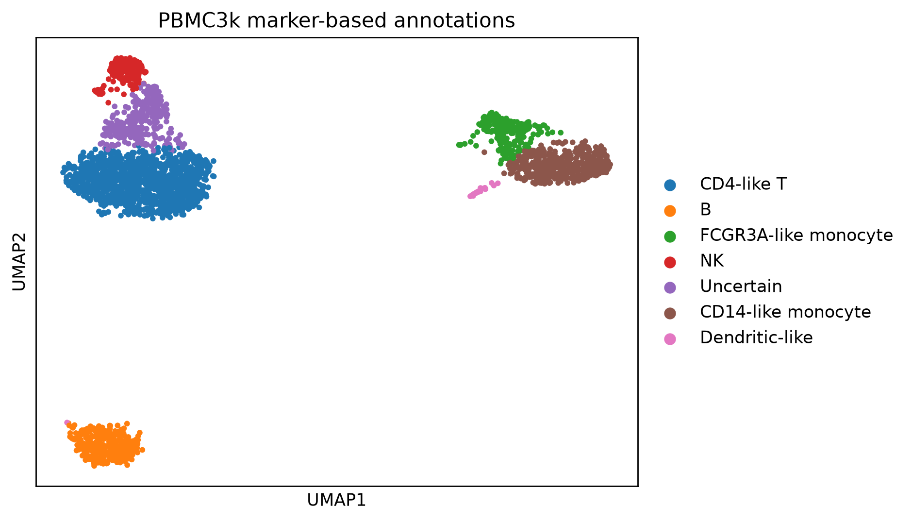
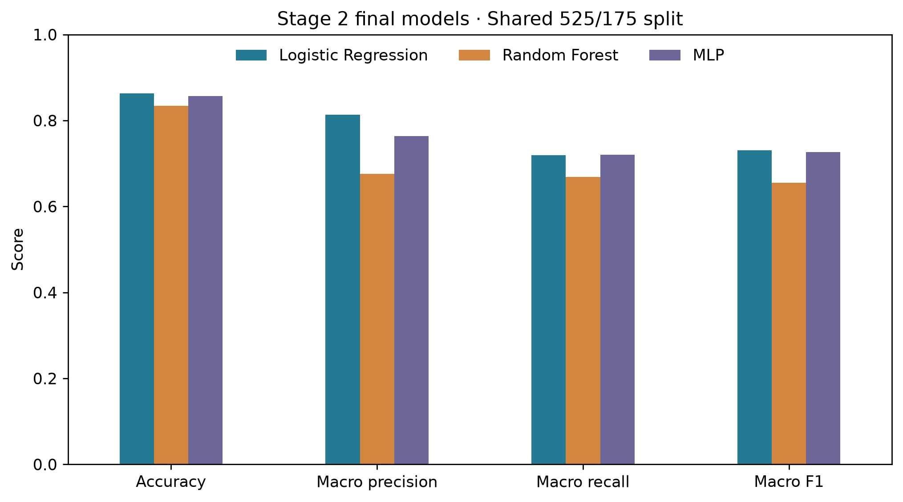

# 基于单细胞 RNA 测序数据的细胞类型识别与机器学习分析

AI4Science · Single-cell RNA-seq Analysis and Cell Type Annotation

本项目在 Apple Silicon CPU 上完成 PBMC3k 的质量控制、降维、Leiden 聚类和标记基因注释，并在 PBMC68k Reduced 上比较 Logistic Regression、Random Forest 和 PyTorch MLP。仓库保存三个版本的真实实验结果，包括预测表、模型参数、图表和中文学习文档。

## 最新实验结果

PBMC3k 从 2,700 × 32,738 的计数矩阵出发，质控后保留 2,641 个细胞、13,602 个基因，分出 7 个群。一个群体保留为 Uncertain。

PBMC68k Reduced 实际为 700 × 765，含 10 类参考标签。v3 先在原训练池内用 420/105 分层划分选择 Epoch，再重新初始化 MLP，在全部 525 个训练细胞上训练。三个最终模型共用原始 175 个测试细胞。

| v3 最终模型 | 训练细胞 | Test Accuracy | Test Macro-F1 |
|---|---:|---:|---:|
| Logistic Regression | 525 | 86.29% | 0.730895 |
| Random Forest | 525 | 83.43% | 0.655670 |
| MLP | 525 | 85.71% | 0.726379 |

MLP 第一阶段在第 11 轮停止，选择第 6 轮，第二阶段从头训练 6 轮。完整数值见[分类指标](results_v3/tables/classification_metrics.csv)。





## 环境与运行

使用 Python 3.11，已在 macOS 15.6、原生 ARM64 的 Conda 环境 ai4sci 上运行。所有模型均使用 CPU，实际依赖版本列于 requirements.txt 和各版本的 run_metadata.json。环境目录由运行机器自行维护。

首次准备依赖可在已有 ai4sci 环境中执行

```bash
conda run -n ai4sci python -m pip install -r requirements.txt
```

也可以将依赖装入项目目录，脚本会加载 .local-deps

```bash
conda run -n ai4sci python -m pip install --target .local-deps -r requirements.txt
```

仅复现最新版分类实验，包括两阶段训练和严格 Early Stopping 对照

```bash
conda run -n ai4sci python src/06_cell_classification.py --output results_v3_recheck
```

从 PBMC3k 开始复现完整流程

```bash
conda run -n ai4sci python run_all.py --output results_full_recheck
```

请使用一个尚未保存分类结果的新输出目录。仓库已附带 results、results_v2 和 results_v3，脚本会保护原结果并检查目标目录。v3 分类会读取原始 results 中的划分表和测试顺序，运行时请保留这些文件。原始 PBMC3k 缓存已放在 data，PBMC68k Reduced 由 Scanpy 随包提供。

第 06 部分 v3 在本机实测 5.181 秒，含三模型训练、严格对照、评估与绘图。早期 v1 完整流程实测 28.21 秒，另一次复跑为 63.49 秒。以上均不含依赖安装和 Word 文档生成，其他机器的耗时会变化。

## 工程结构

| 位置 | 内容 |
|---|---|
| data/pbmc3k_raw.h5ad | PBMC3k 原始计数缓存 |
| src/01_data_exploration.py 至 05_cell_annotation.py | 数据探索、QC、预处理、聚类和多基因注释 |
| src/06_cell_classification.py | 当前 v3 两阶段分类实验及严格 Early Stopping 对照 |
| src/*.md | 项目学习笔记 |
| run_all.py | 六阶段统一入口 |
| test_data.py | 原始数据探索脚本 |
| results/ | v1 单细胞分析与固定 60 轮分类结果 |
| results_v2/ | 420/105 验证集与 Early Stopping 实验 |
| results_v3/ | 选轮后用全部 525 个细胞重训的最新结果 |
| results_v3/early_stopping_control/ | 固定 420 个训练细胞的 A/B 轮数策略对照 |
| results_review/ | 图表学习笔记 |
| docs/ | 中文实验报告、学习手册、导师汇报提纲与 scGPT 专题 |

每个结果目录中的 figures 保存 PNG，tables 保存逐细胞划分、预测、混淆矩阵和指标，models 保存权重及基因、类别顺序。results/pbmc3k_processed.h5ad 保存原始计数层、对数表达、PCA、邻接图、UMAP 和注释。

## 怎样查看只改变早停策略的实验

要评价早停策略，请查看 [严格 A/B 对照](results_v3/early_stopping_control/metrics.csv)。
A 和 B 都有相同的 420 个训练细胞、105 个验证细胞和 175 个测试细胞。
A 每轮也记录验证指标，但固定采用第 60 轮参数。B 用验证 Loss 触发早停并恢复最低 Loss 的参数。
两者的网络、优化器、初始化和批次顺序相同，共同训练前缀已经逐轮核对。

历史 v1 是初版已有结果，使用 525 个细胞固定训练 60 轮，当时没有留出验证集。
v3 的最终模型经过选轮后在全部 525 个细胞上重新训练。因此，历史 v1 和 v3 的直接比较不能回答
“仅加入早停有什么影响”。固定训练 60 轮的方法也可以设置验证集，严格对照 A 正是这样实现的。

## 历史版本记录

| 版本 | MLP 梯度训练数据 | 验证数据 | 轮数协议 |
|---|---|---|---|
| v1 | 525 个细胞 | 无 | 固定 60 轮 |
| v2 | 420 个细胞 | 105 个细胞 | Early Stopping 后恢复最佳验证模型 |
| v3 | 最终 525 个细胞 | 第一阶段 105 个细胞 | 420/105 选轮，再从头使用 525 个细胞训练 |

[版本对比 CSV](results_v3/tables/experiment_comparison.csv)记录真实指标。训练样本数、行顺序和选轮协议存在差异，不能把版本间的性能差异直接解释为 Early Stopping 带来的提升。v3 按原划分表顺序固定训练池，内部选轮子集与 v2 也存在差异。

额外的严格对照固定同一 420/105/175 划分、初始化及批次顺序，比较 A 的第 60 轮与 B 的最佳验证轮。B 停止前 11 轮的损失、参数哈希和批次顺序均通过一致性检查。

| 严格对照 | 模型 Epoch | Validation Loss | Test Accuracy | Test Macro-F1 |
|---|---:|---:|---:|---:|
| A 固定 60 轮 | 60 | 0.619694 | 86.29% | 0.730546 |
| B Early Stopping | 6 | 0.475857 | 85.71% | 0.734767 |

该对照的训练规模为 420，结果单独保存在 [early_stopping_control](results_v3/early_stopping_control)。测试评分在各自模型确定后执行，模型选择使用验证损失。

## 中文文档阅读顺序

1. [零基础学习手册](docs/AI4Science_零基础学习手册.docx)讲解生物学背景、AnnData、QC、降维、聚类、监督学习和指标。其代码与结果对应 v1。
2. [实验报告](docs/AI4Science_实验报告.docx)记录初版完整实践。
3. [v2 实验说明](results_v2/MLP_v2_结果说明.md)介绍验证集与提前停止。
4. [v3 实验结果说明](results_v3/实验结果说明.md)详细说明两阶段训练、全部图表、CSV 和严格对照。
5. [导师汇报提纲](docs/导师汇报提纲.md)提供初版 5–8 分钟汇报与问答，可结合 v3 更新模型指标。
6. [scGPT 专题](docs/scGPT_专题.md)讲解 Transformer 与单细胞模型。scGPT 尚未实际运行。

## 复现记录与局限

[初版复现记录](results/reproducibility.json)、[v2 验证记录](results_v2/verification.json)和[v3 验证记录](results_v3/verification.json)保存已经执行的检查。v3 核对了最终模型的 525 个训练细胞、测试顺序、Scaler 拟合范围以及从头重训的参数一致性。更换依赖版本或硬件可能影响数值结果。

单细胞类型注释属于多基因证据支持的候选判断，双细胞检测尚未实施。分类最小类别的测试集只有 2 个细胞，单次留出和类别不平衡会影响稳定性。PBMC68k Reduced 是发布前已经预处理的子集，上游特征处理无法按当前切分重新拟合。跨供体或跨平台泛化仍需独立数据验证。

重新加载模型时，应按 models/feature_label_mapping.json 对齐基因和类别顺序。MLP 使用相应阶段的 Scaler 后再取 logits 的 argmax，joblib 模型按其保存的流程调用 predict。

## 数据与方法来源

PBMC 数据来自 10x Genomics 的公开外周血单个核细胞数据，经 Scanpy 提供。仓库中的数据缓存用于复现分析。

- [Scanpy PBMC3k 接口](https://scanpy.readthedocs.io/en/stable/generated/scanpy.datasets.pbmc3k.html)
- [Scanpy PBMC68k Reduced 接口](https://scanpy.readthedocs.io/en/stable/generated/scanpy.datasets.pbmc68k_reduced.html)
- [Scanpy 单细胞预处理与聚类](https://scanpy.readthedocs.io/en/1.11.x/tutorials/basics/clustering.html)
- [scGPT 官方项目](https://github.com/bowang-lab/scGPT)

## 常见问题

- 找不到依赖。用 conda run -n ai4sci python -c "import sys; print(sys.executable)" 检查解释器，按上方命令补齐依赖。
- 输出目录已存在。使用新的 --output 目录名，原版本保留用于比较。
- Numba 缓存不可写。将项目移到可写目录，或设置 NUMBA_CACHE_DIR 指向可写缓存。
- 稀疏矩阵中心化提示。PCA 的缩放仅针对 HVG 副本，保存的全基因表达仍保留稀疏表示。
