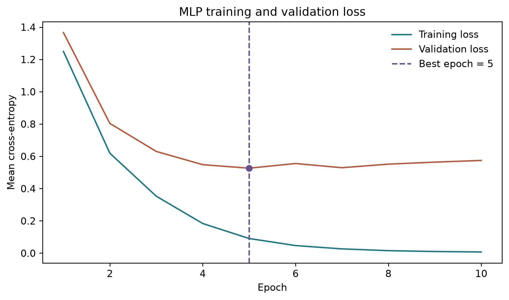

# MLP 验证集与 Early Stopping 实验结果

本次修改已在原桌面项目的 ai4sci 环境中实际运行。执行入口为 src/06_cell_classification.py，CPU 使用 2 个线程，分类及绘图实测耗时 3.107 秒。输出写入 results_v2。原 results 中全部 46 个文件经 SHA-256 核对保持一致。

## 数据划分和标准化

原实验为 525 个训练细胞、175 个测试细胞。本次读取原 classification_split.csv 并逐细胞核对标签与划分，测试细胞和最终预测表的细胞顺序均一致。在原 525 个训练细胞中，以随机种子 42、按类分层的 80%/20% 划分得到 420 个训练细胞和 105 个验证细胞。

| 类别 | 训练 | 验证 | 测试 |
|---|---:|---:|---:|
| CD14+ Monocyte | 78 | 19 | 32 |
| CD19+ B | 57 | 14 | 24 |
| CD34+ | 8 | 2 | 3 |
| CD4+/CD25 T Reg | 41 | 10 | 17 |
| CD4+/CD45RA+/CD25- Naive T | 5 | 1 | 2 |
| CD4+/CD45RO+ Memory | 11 | 3 | 5 |
| CD56+ NK | 18 | 5 | 8 |
| CD8+ Cytotoxic T | 33 | 8 | 13 |
| CD8+/CD45RA+ Naive Cytotoxic | 25 | 7 | 11 |
| Dendritic | 144 | 36 | 60 |
| 合计 | 420 | 105 | 175 |

每个类别在三个子集中均有样本。最小类只有 5 个训练细胞、1 个验证细胞和 2 个测试细胞，因此逐类表现和宏平均存在较大抽样波动。

为使本次三模型的训练样本一致，逻辑回归、随机森林和 MLP 都只在同一组 420 个细胞上拟合。逻辑回归的 Pipeline 和 MLP 的 StandardScaler 都仅在训练子集拟合。MLP 的验证和测试输入只做 transform。随机森林直接读取已有表达特征。逻辑回归与随机森林沿用固定参数，MLP 额外使用验证集决定停止时刻与最佳 Epoch。

PBMC68k Reduced 由 Scanpy 作为已预处理数据发布。本次项目内 scaler 的拟合遵守训练边界，上游发布数据的特征筛选和预处理仍无法按本次划分重新拟合。

## MLP 训练和模型选择

网络仍为 765 → 128 → 64 → 10，隐层用 ReLU，训练输入为 logits，损失为 CrossEntropyLoss。批大小 32，Adam 学习率 0.001、weight_decay 0.0001。

每个 Epoch 更新参数后，用该轮结束时的同一组参数分别计算全训练子集和全验证集的平均交叉熵，并记录 Validation Accuracy 与 Validation Macro-F1。这种 Training Loss 的统计方法与旧版逐批更新过程中的加权损失有所不同。

- max_epochs 为 60，patience 为 5，min_delta 为 0.0001。
- 当验证 Loss 相对上一次明显改善的参考值下降超过 min_delta 时，耐心计数归零，否则加一。
- 连续 5 轮未明显改善时停止。
- 单独保存验证 Loss 绝对最低时的参数快照，使用 detach().cpu().clone() 防止后续参数更新修改快照。
- min_delta 决定何时重置计数，最低验证 Loss 决定保留哪一轮。这能保留小于 min_delta 的微小下降所对应的最低 Loss 权重。
- 停止后先 load_state_dict 恢复最佳快照，再对独立测试集计算一次 logits、Test Loss 和预测，不依据测试指标修改 Epoch。

## 实际结果

| 记录 | 结果 |
|---|---:|
| 最佳 Epoch | 5 |
| 停止 Epoch | 10 |
| 最佳 Validation Loss | 0.526380 |
| 最佳轮 Validation Accuracy | 80.00% |
| 最佳轮 Validation Macro-F1 | 0.630551 |
| 最终 Test Loss | 0.457333 |
| 最终 Test Accuracy | 84.00% |
| 最终 Test Macro-F1 | 0.675457 |

第 5 轮 Training Loss 为 0.090686，Validation Loss 为 0.526380。第 10 轮 Training Loss 降至 0.007219，Validation Loss 升至 0.574224。训练拟合持续增强，但验证 Loss 已经没有改善，Early Stopping 在第 10 轮触发，并恢复第 5 轮参数。

第 4 轮验证 Accuracy 为 81.90%，高于第 5 轮的 80.00%。本次预先指定的模型选择标准是 Validation Loss，因此保存第 5 轮。验证 Accuracy 和 Macro-F1 用于观察，没有参与选择 Epoch。



## 同一新划分下的三模型对照

| 模型 | Accuracy | Macro Precision | Macro Recall | Macro-F1 |
|---|---:|---:|---:|---:|
| Logistic Regression | 0.845714 | 0.706693 | 0.688893 | 0.685735 |
| Random Forest | 0.840000 | 0.688807 | 0.679493 | 0.663630 |
| MLP | 0.840000 | 0.692378 | 0.683877 | 0.675457 |

本次固定划分中，逻辑回归的 Accuracy 与 Macro-F1 最高。MLP 的 Macro-F1 高于随机森林。模型训练数据和测试数据一致，只有 MLP 使用验证集选择训练轮次。这里记录的是单次留出比较。

## 与旧实验的关系

| MLP 实验 | 梯度训练细胞 | 验证细胞 | 测试细胞 | Epoch 规则 | Test Accuracy | Test Macro-F1 |
|---|---:|---:|---:|---|---:|---:|
| 原 results | 525 | 0 | 175 | 固定 60 轮 | 0.862857 | 0.741083 |
| 新 results_v2 | 420 | 105 | 同一批 175 | 第 10 轮停止，恢复第 5 轮 | 0.840000 | 0.675457 |

新旧实验不再是完全相同的训练条件。训练样本量、Epoch 规则和 Loss 记录口径都有变化，因此新旧分数差不能单独归因于 Early Stopping。此次目标是建立验证集驱动的训练流程。新实验的超参数和模型选择标准在测试前固定，未依据新测试表现重训或重新选轮。

## 文件和复现

- tables/mlp_training.csv 保存五列，即 epoch、train_loss、validation_loss、validation_accuracy、validation_macro_f1。
- tables/mlp_best_epoch.json 保存最佳轮、最低验证 Loss、停止轮、阈值与数据规模。
- tables/mlp_test_metrics.json 保存最终一次测试的 Loss、Accuracy、Macro-F1。
- tables/classification_split.csv 与 class_counts.csv 保存逐细胞划分和每类规模。
- tables/classification_metrics.csv、classification_predictions.csv、confusion_*.csv 与 per_class_*.csv 保存新对照结果。
- models/mlp.pt 是最佳轮权重，models/mlp_scaler.joblib 是在 420 个训练细胞上拟合的缩放器。
- figures/mlp_train_validation_loss.png 同图绘制训练与验证 Loss，并标记最佳 Epoch。
- verification.json 记录保存模型、划分、指标和原结果哈希核验。

已从保存的 MLP 权重重新计算验证 Loss，确认与第 5 轮记录一致。测试指标从保存的预测表复算，核验阶段未再次运行测试前向计算。

在桌面原项目首次运行的命令为

```bash
conda run -n ai4sci python src/06_cell_classification.py
```

results_v2 已保存本次成果。再次复现时指定一个新的输出目录

```bash
cd ~/Desktop/single_cell_project
conda run -n ai4sci python src/06_cell_classification.py --output results_v2_recheck
```

为保护原成果，脚本会拒绝向原 results 写入或覆盖已有分类结果。run_all.py 的默认输出也改成 results_v2，并在执行任何阶段前检查目标目录。完整流水线复跑可用 python run_all.py --output results_v2_full_recheck。
